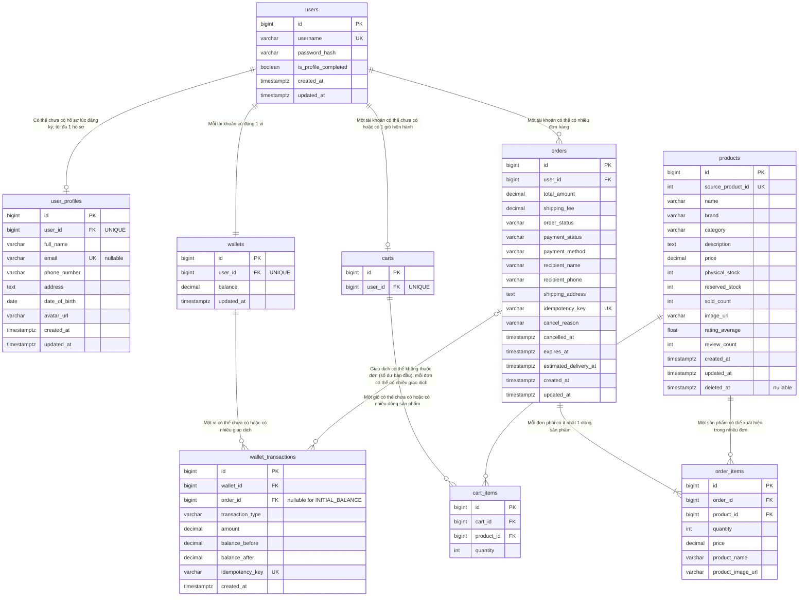

# ShopFlow - Database Design Specification

# 1. Sơ đồ Quan hệ Thực thể (Entity Relationship Diagram - ERD)



**Cách đọc quan hệ trong sơ đồ:** `||` nghĩa là bắt buộc có đúng 1 bản ghi; `o|` nghĩa là có thể không có hoặc có 1; `o{` nghĩa là có thể không có hoặc có nhiều; `|{` nghĩa là phải có ít nhất 1. Ví dụ, một tài khoản có thể chưa có hồ sơ khi đăng ký nhưng không thể có nhiều hơn một hồ sơ.

# 2. Mô tả ngắn các bảng dữ liệu

- users: Quản lý thông tin tài khoản và xác thực người dùng.
- user_profiles:  Quản lý hồ sơ cá nhân người dùng.
- products: Quản lý thông tin sản phẩm, giá bán, bộ lọc và số lượng tồn kho.
- wallets: Quản lý số dư ví giả lập.
- carts: Quản lý giỏ hàng thuộc về người dùng nào.
- cart_items: Lưu chi tiết danh sách các sản phẩm trong giỏ hàng.
- orders: Lưu thông tin tổng thể đơn hàng, trạng thái, địa chỉ giao hàng và thanh toán.
- wallet_transactions: Ghi nhận giao dịch cấp số dư ban đầu, thanh toán và hoàn tiền trong ví giả lập.
- order_items: Lưu chi tiết từng sản phẩm tại thời điểm giao dịch trong đơn hàng.

# 3. Từ điển dữ liệu

## 3.1. Bảng users

| Tên cột | Kiểu dữ liệu | Quy tắc dữ liệu | Mô tả |
| --- | --- | --- | --- |
| id | BigInt | Primary Key, Auto Increment | Mã định danh duy nhất của tài khoản người dùng |
| username | VarChar(50) | Unique, Not Null | Tên đăng nhập |
| password_hash | VarChar(255) | Not Null | Mật khẩu được mã hóa |
| is_profile_completed | Boolean  | Not Null Default: FALSE | Đánh dấu hồ sơ đã đủ họ tên, số điện thoại và địa chỉ. Mặc định FALSE khi đăng ký; chuyển thành TRUE sau khi người dùng hoàn tất hồ sơ. |
| created_at | TIMESTAMPTZ | Default: Current Timestamp | Thời điểm tạo tài khoản |
| updated_at | TIMESTAMPTZ | Default: Current Timestamp | Thời điểm cập nhật thông tin tài khoản |

**Ý nghĩa các điều kiện của bảng:** `id` là mã riêng tự tăng cho từng tài khoản. `username` bắt buộc và không được trùng, nên không thể tạo hai tài khoản cùng tên đăng nhập. `password_hash` bắt buộc lưu giá trị đã băm thay vì mật khẩu gốc. `is_profile_completed` mặc định là `FALSE` và chuyển thành `TRUE` khi hồ sơ có đủ thông tin bắt buộc.

## 3.2. Bảng user_profiles

| Tên cột | Kiểu dữ liệu | Quy tắc dữ liệu | Mô tả |
| --- | --- | --- | --- |
| id | BigInt | Primary Key, Auto Increment | Mã định danh duy nhất của thông tin người dùng |
| user_id | BigInt | Foreign Key (users.id), On Delete Cascade, Unique, Not Null | Mã người dùng sở hữu các trường thông tin này |
| full_name | VarChar(100) | Not Null | Họ và tên người dùng |
| email | VarChar(100) | Unique, Nullable | Email của người dùng (không bắt buộc theo PRD v1.0) |
| phone_number | VarChar(15) | Not Null | Số điện thoại của người dùng |
| address | Text | Not Null | Địa chỉ giao hàng |
| date_of_birth | Date | Nullable | Ngày sinh của người dùng |
| avatar_url | VarChar(500) | Nullable | Hình ảnh đại diện |
| created_at | TIMESTAMPTZ | Default: Current Timestamp | Thời gian tạo hồ sơ |
| updated_at | TIMESTAMPTZ | Default: Current Timestamp | Thời gian cập nhật hồ sơ |

**Ý nghĩa các điều kiện của bảng:** `user_id` vừa phải trỏ tới một tài khoản có thật, vừa không được trùng; vì vậy mỗi hồ sơ thuộc về đúng một tài khoản và mỗi tài khoản có tối đa một hồ sơ. Nếu tài khoản bị xóa, hồ sơ phụ thuộc cũng bị xóa theo (`ON DELETE CASCADE`). Họ tên, số điện thoại và địa chỉ là bắt buộc để hồ sơ đủ điều kiện đặt hàng; email, ngày sinh và ảnh đại diện có thể để trống.

## 3.3. Bảng wallets

| Tên cột | Kiểu dữ liệu | Quy tắc dữ liệu | Mô tả |
| --- | --- | --- | --- |
| id | BigInt | Primary Key, Auto Increment | Mã định danh duy nhất của ví giả lập |
| user_id | BigInt | Unique, Not Null, Foreign Key (users.id), ON DELETE RESTRICT | Mã người dùng sở hữu ví giả lập |
| balance | Decimal(12,2) | Not Null, Default: 0.00, CHECK (balance >= 0) | Số dư hiện tại của ví giả lập, tính bằng VNĐ; số dư ban đầu được ghi nhận qua giao dịch INITIAL_BALANCE |
| updated_at | TIMESTAMPTZ | Default: Current Timestamp | Thời điểm cập nhật số dư gần nhất; backend cập nhật trường này mỗi khi số dư thay đổi |

**Ý nghĩa các điều kiện của bảng:** `user_id` phải trỏ tới một tài khoản có thật và chỉ xuất hiện một lần trong bảng ví; do đó một tài khoản có tối đa một ví. `balance` không được để trống, bắt đầu từ 0.00 nếu chưa có giá trị khác và không thể âm.

Không thể xóa tài khoản khi tài khoản đó có ví giả lập (ON DELETE RESTRICT).

## 3.4. Bảng products

| Tên cột | Kiểu dữ liệu | Quy tắc dữ liệu | Mô tả |
| --- | --- | --- | --- |
| id | BigInt | Primary Key, Auto Increment | Mã định danh duy nhất của sản phẩm trong ShopFlow |
| source_product_id | Integer | Not Null, Unique | Mã sản phẩm tương ứng từ DummyJSON; dùng ánh xạ dữ liệu nguồn với khóa nội bộ products.id |
| name | VarChar(255) | Not Null | Tên của sản phẩm |
| brand | VarChar(50) | Nullable | Hãng/Thương hiệu sản phẩm |
| description  | Text | Nullable | Mô tả thông tin chi tiết sản phẩm |
| price | Decimal(12,2) | Not Null, CHECK (price > 0) | Giá của sản phẩm |
| physical_stock | Integer | Not Null, Default: 0, CHECK (physical_stock >= 0) | Số lượng tồn kho thực tế của sản phẩm |
| reserved_stock | Integer | Not Null, Default: 0, CHECK (reserved_stock >= 0 AND reserved_stock <= physical_stock) | Số lượng tồn kho tạm giữ của sản phẩm |
| image_url | VarChar(500) | Nullable | Link hình ảnh của sản phẩm |
| rating_average | Float | Default: 0.0, CHECK (rating_average BETWEEN 0 AND 5) | Điểm đánh giá trung bình của sản phẩm |
| review_count | Integer | Default: 0, CHECK (review_count >= 0) | Tổng số lượt đánh giá |
| category | VarChar(100) | Nullable | Danh mục sản phẩm |
| sold_count | Integer | Not Null, Default: 0, CHECK (sold_count >= 0) | Tổng số đơn vị đã bàn giao cho vận chuyển; dùng để xếp hạng sản phẩm bán chạy |
| created_at | TIMESTAMPTZ | Not Null, Default: Current Timestamp | Thời điểm sản phẩm được thêm vào ShopFlow |
| updated_at | TIMESTAMPTZ | Not Null, Default: Current Timestamp | Thời điểm thông tin sản phẩm được cập nhật gần nhất; ứng dụng cập nhật giá trị này khi sửa bản ghi |
| deleted_at | TIMESTAMPTZ | Nullable | Thời điểm sản phẩm được ẩn khỏi danh mục; NULL nghĩa là sản phẩm vẫn đang hiển thị |

**Ý nghĩa các điều kiện và số liệu tồn kho:** Giá sản phẩm phải lớn hơn 0; tồn kho thực tế, lượng đang giữ và số lượt bán không được âm; điểm đánh giá nằm trong khoảng 0 đến 5. `physical_stock` là số hàng hiện có, còn `reserved_stock` là số hàng đã dành cho đơn chưa bàn giao. Lượng đang giữ không thể lớn hơn tồn thực tế; số có thể đặt bằng `physical_stock - reserved_stock`. Khi tạo đơn, số lượng đặt được cộng vào lượng đang giữ. Nếu đơn bị hủy trước khi bàn giao, lượng giữ được trả lại. Khi đơn chuyển sang đang giao, lượng đang giữ và tồn thực tế cùng giảm đúng một lần. `created_at` và `updated_at` ghi nhận thời điểm tạo và cập nhật bản ghi; `deleted_at` dùng để ẩn sản phẩm mà không xóa dòng dữ liệu. Sản phẩm có `deleted_at` khác NULL không xuất hiện trong danh mục, nhưng vẫn được giữ để các đơn hàng cũ tiếp tục tham chiếu.

## 3.5. Bảng carts

| Tên cột | Kiểu dữ liệu | Quy tắc dữ liệu | Mô tả |
| --- | --- | --- | --- |
| id | BigInt | Primary Key, Auto Increment | Mã định danh duy nhất của giỏ hàng |
| user_id | BigInt | Not Null, Foreign Key (users.id), Unique, ON DELETE CASCADE | Mã người dùng sở hữu giỏ hàng |

**Ý nghĩa các điều kiện của bảng:** `user_id` phải thuộc về một tài khoản có thật và không được trùng, nên một tài khoản chỉ có tối đa một giỏ hàng.

Khi xóa người dùng thì giỏ hàng và các thông tin giỏ hàng cũng bị xóa ( ON DELETE CASCADE)

## 3.6. Bảng cart_items

| Tên cột | Kiểu dữ liệu | Quy tắc dữ liệu | Mô tả |
| --- | --- | --- | --- |
| id | BigInt | Primary Key, Auto Increment | Mã định danh duy nhất của chi tiết giỏ hàng |
| cart_id | BigInt | Not Null, Foreign Key (carts.id), ON DELETE CASCADE | Mã giỏ hàng chứa các sản phẩm  |
| product_id | BigInt | Not Null, Foreign Key (products.id), ON DELETE CASCADE | Mã sản phẩm được đặt trong giỏ hàng |
| quantity | Integer | Not Null, CHECK (quantity >= 1) | Số lượng chọn mua |

**Ràng buộc cấp bảng:** `UNIQUE (cart_id, product_id)`.

**Ý nghĩa các điều kiện của bảng:** Mỗi dòng phải gắn với một giỏ hàng có thật và một sản phẩm có thật. Số lượng phải từ 1 trở lên. Ràng buộc trên không cho phép cùng sản phẩm xuất hiện thành nhiều dòng trong một giỏ; khi khách đổi số lượng, cập nhật dòng hiện có. `ON DELETE CASCADE` nghĩa là khi xóa giỏ hàng hoặc sản phẩm, các dòng giỏ hàng tương ứng tự bị xóa theo.

## 3.7. Bảng orders

| Tên cột | Kiểu dữ liệu | Quy tắc dữ liệu | Mô tả |
| --- | --- | --- | --- |
| id | BigInt | Primary Key, Auto Increment | Mã định danh duy nhất của đơn hàng |
| user_id | BigInt | Not Null, Foreign Key (users.id), ON DELETE RESTRICT | Mã người dùng sở hữu đơn hàng này |
| total_amount | Decimal(12,2) | Not Null, CHECK (total_amount >= 0) | Tổng tiền hàng cộng phí vận chuyển (sum(order_items.quantity * order_items.price) + shipping_fee) |
| order_status | VarChar(30) | Not Null, CHECK (order_status IN ('PENDING_PAYMENT', 'AWAITING_CONFIRMATION', 'PROCESSING', 'SHIPPING', 'COMPLETED', 'CANCELLED')); không có giá trị mặc định vì COD và Ví giả lập bắt đầu ở trạng thái khác nhau. | Các trạng thái: PENDING_PAYMENT(chờ thanh toán), AWAITING_CONFIRMATION(chờ xác nhận), PROCESSING(đang chuẩn bị), SHIPPING(đang giao), COMPLETED(hoàn thành), CANCELLED(đã hủy). |
| payment_status | VarChar(30) | Not Null, Default: 'UNPAID', CHECK (payment_status IN ('UNPAID', 'PAID', 'REFUNDED')) | UNPAID(chưa thanh toán), PAID(đã thanh toán), REFUNDED(đã hoàn tiền). |
| payment_method | VarChar(30) | Not Null, CHECK (payment_method IN ('COD', 'MOCK_WALLET')) | COD (thanh toán khi nhận hàng) hoặc MOCK_WALLET(ví giả lập). |
| shipping_fee | Decimal(12,2) | Not Null, Default: 0.00, CHECK (shipping_fee >= 0) | Phí vận chuyển |
| recipient_name | VarChar(100) | Not Null | Tên người nhận hàng |
| recipient_phone | VarChar(15) | Not Null | Số điện thoại người nhận hàng |
| shipping_address | Text | Not Null | Địa chỉ giao hàng |
| estimated_delivery_at | TIMESTAMPTZ | Nullable | Thời gian giao dự kiến |
| expires_at | TIMESTAMPTZ | Nullable | Thời gian hết hạn đơn hàng |
| created_at | TIMESTAMPTZ | Default: Current Timestamp | Thời điểm tạo đơn |
| updated_at | TIMESTAMPTZ | Default: Current Timestamp | Thời điểm chuyển giao trạng thái đơn |
| idempotency_key | VarChar(64) | Unique, Not Null | Idempotency Key Chống Tạo Đơn Trùng Lặp |
| cancel_reason | VarChar(255) | Nullable | Lý do hủy đơn |
| cancelled_at | TIMESTAMPTZ | Nullable | Thời điểm hủy đơn |

**Trạng thái ban đầu:** Đơn Ví giả lập bắt đầu ở `PENDING_PAYMENT` (chờ thanh toán); đơn COD (thanh toán khi nhận hàng) bắt đầu ở `AWAITING_CONFIRMATION` (chờ xác nhận).

**Ý nghĩa các điều kiện của bảng:** Mỗi đơn phải thuộc về một tài khoản có thật. `ON DELETE RESTRICT` nghĩa là không thể xóa tài khoản khi tài khoản đó còn đơn hàng, để lịch sử mua hàng không bị mất. `total_amount` và `shipping_fee` không được âm; `payment_method`, `payment_status` và `order_status` chỉ nhận các giá trị đã liệt kê. `idempotency_key` bắt buộc và không trùng, giúp một lần gửi yêu cầu không tạo nhiều đơn.

## 3.8. Bảng wallet_transactions

| Tên cột | Kiểu dữ liệu | Quy tắc dữ liệu | Mô tả |
| --- | --- | --- | --- |
| id | BigInt | Primary Key, Auto Increment | Mã định danh duy nhất của giao dịch ví |
| wallet_id | BigInt | Not Null, Foreign Key (wallets.id), ON DELETE RESTRICT | Ví phát sinh giao dịch |
| order_id | BigInt | Nullable, Foreign Key (orders.id), CHECK ((transaction_type = 'INITIAL_BALANCE' AND order_id IS NULL) OR (transaction_type IN ('PAYMENT', 'REFUND') AND order_id IS NOT NULL)), ON DELETE RESTRICT | Đơn hàng liên quan; chỉ giao dịch INITIAL_BALANCE được để trống |
| transaction_type | VarChar(20) | Not Null, CHECK (transaction_type IN ('INITIAL_BALANCE', 'PAYMENT', 'REFUND')) | Loại giao dịch: INITIAL_BALANCE (cấp số dư ban đầu), PAYMENT (thanh toán) hoặc REFUND (hoàn tiền) |
| amount | Decimal(12,2) | Not Null, CHECK (amount > 0) | Số tiền giao dịch bằng VNĐ, luôn là số dương |
| balance_before | Decimal(12,2) | Not Null, CHECK (balance_before >= 0) | Số dư ví trước khi ghi nhận giao dịch; không được âm |
| balance_after | Decimal(12,2) | Not Null, CHECK (balance_after >= 0) | Số dư ví sau khi ghi nhận giao dịch; không được âm |
| created_at | TIMESTAMPTZ | Default: Current Timestamp | Thời điểm phát sinh giao dịch |
| idempotency_key | VarChar(64) | UNIQUE, NOT NULL | Idempotency Key chống trừ tiền 2 lần |

**Ràng buộc cấp bảng cho loại giao dịch và số dư:** Giao dịch cấp ban đầu không thuộc đơn và bắt đầu từ số dư 0; thanh toán và hoàn tiền phải gắn với một đơn. Công thức số dư sau phải khớp với loại giao dịch.

```sql
CONSTRAINT ck_wallet_transaction_balance CHECK (
    (transaction_type = 'INITIAL_BALANCE'
        AND order_id IS NULL
        AND balance_before = 0
        AND balance_after = balance_before + amount)
 OR (transaction_type = 'PAYMENT'
        AND order_id IS NOT NULL
        AND balance_after = balance_before - amount)
 OR (transaction_type = 'REFUND'
        AND order_id IS NOT NULL
        AND balance_after = balance_before + amount)
)
```

**Ý nghĩa các điều kiện của bảng:** `wallet_id` phải trỏ tới ví có thật. Các `CHECK` không cho ghi giao dịch với số dư âm, sai quan hệ giữa `order_id` và loại giao dịch, hoặc tính sai số dư sau. `transaction_type` chỉ nhận ba loại đã nêu; số tiền giao dịch phải lớn hơn 0; `idempotency_key` bắt buộc và không trùng để không ghi nhận cùng một lần thanh toán hai lần. Các `CHECK` này kiểm tra từng dòng giao dịch; cập nhật số dư ví, ghi lịch sử và đổi trạng thái đơn vẫn phải được lưu cùng nhau trong một giao dịch cơ sở dữ liệu. Vì `CHECK` không đối chiếu được với dòng `PAYMENT` khác, ứng dụng phải xác nhận số tiền `REFUND` bằng toàn bộ số tiền đã thanh toán khi xử lý hoàn tiền.

Không thể xóa ví điện tử khi có giao dịch tồn tại (ON DELETE RESTRICT)

## 3.9. Bảng order_items

| Tên cột | Kiểu dữ liệu | Quy tắc dữ liệu | Mô tả |
| --- | --- | --- | --- |
| id | BigInt | Primary Key, Auto Increment | Mã định danh duy nhất của chi tiết đơn hàng |
| order_id | BigInt | Not Null, Foreign Key (orders.id), ON DELETE RESTRICT | Mã đơn hàng chứa các sản phẩm đã mua |
| product_id | BigInt | Not Null, Foreign Key (products.id), ON DELETE RESTRICT | Mã sản phẩm đã mua |
| quantity | Integer | Not Null, CHECK (quantity >= 1) | Số lượng của sản phẩm mua |
| price | Decimal(12,2) | Not Null, CHECK (price >= 0) | Giá bán tại thời điểm chốt đơn |
| product_name | VarChar(255) | Not Null | Tên sản phẩm |
| product_image_url | VarChar(500) | Not Null | Hình ảnh sản phẩm |

**Ràng buộc cấp bảng:** `UNIQUE (order_id, product_id)`.

**Ý nghĩa các điều kiện của bảng:** Mỗi dòng phải trỏ tới một đơn hàng và một sản phẩm có thật; số lượng ít nhất là 1; giá tại thời điểm mua không được âm. Ràng buộc trên không cho cùng một sản phẩm xuất hiện thành nhiều dòng trong một đơn. Tên, ảnh và giá được lưu như bản chụp lúc mua, để thay đổi sản phẩm sau này không làm đổi lịch sử đơn. `ON DELETE RESTRICT` ngăn xóa đơn hoặc sản phẩm còn được những dòng chi tiết này sử dụng.

## 4. Mô tả thiết kế dữ liệu phiên bản 1 (PostgreSQL)

### 4.1. Tài khoản người dùng

Trong phiên bản 1, tất cả tài khoản đều là tài khoản khách hàng. Bảng `users` không có cột `role` (vai trò) vì dự án chưa có giao diện quản trị hoặc chức năng dành riêng cho quản trị viên. Các thao tác vận hành cửa hàng được mô phỏng, không phải một loại tài khoản đăng nhập riêng.

### 4.2. Hồ sơ cá nhân và điều kiện đặt hàng

- Khi đăng ký, hệ thống tạo tài khoản bằng tên đăng nhập và mã băm mật khẩu. Người dùng được phép bỏ qua việc tạo hồ sơ lúc này.
- Hồ sơ gồm họ tên (`full_name`), số điện thoại (`phone_number`) và địa chỉ (`address`); cả ba thông tin này bắt buộc khi hồ sơ được tạo. Email, ngày sinh và ảnh đại diện là thông tin không bắt buộc.
- `is_profile_completed` cho biết hồ sơ đã đủ ba thông tin bắt buộc hay chưa: `FALSE` khi tài khoản mới đăng ký hoặc hồ sơ còn thiếu; `TRUE` sau khi hồ sơ được hoàn tất.
- Hồ sơ là điều kiện bắt buộc để đặt hàng. Nếu người dùng bỏ qua hồ sơ lúc đăng ký nhưng sau đó chọn đặt hàng, ứng dụng yêu cầu hoàn tất hồ sơ và chưa tạo đơn cho tới khi họ lưu đủ họ tên, số điện thoại và địa chỉ.
- Khi đơn được tạo, họ tên, số điện thoại và địa chỉ hiện tại được sao chép vào các cột `recipient_name`, `recipient_phone` và `shipping_address` của `orders`. Đây là bản chụp thông tin giao hàng lúc mua: nếu người dùng sửa hồ sơ sau này, đơn cũ vẫn giữ địa chỉ đã dùng khi đặt.
- Access Token (mã truy cập) và Refresh Token (mã làm mới) được lưu an toàn trên thiết bị theo PRD. Phiên bản 1 không lưu các mã này trong cơ sở dữ liệu; thao tác đăng xuất xóa chúng khỏi thiết bị.

### 4.3. Sản phẩm và nguồn dữ liệu

- `products.id` là mã sản phẩm nội bộ của ShopFlow. `source_product_id` lưu mã tương ứng của sản phẩm trong DummyJSON; mã này bắt buộc có và không được trùng để mỗi sản phẩm nguồn chỉ ánh xạ tới một sản phẩm trong ShopFlow.
- Tên, mô tả, giá, hãng, danh mục và đánh giá được lấy từ nguồn sản phẩm theo phạm vi PRD. Tồn kho thực tế (`physical_stock`), lượng đang giữ cho đơn (`reserved_stock`) và số lượng đã bán (`sold_count`) do ShopFlow quản lý; dữ liệu nguồn không ghi đè các giá trị này.
- `sold_count` là tổng số sản phẩm đã bàn giao cho vận chuyển. Chỉ tăng khi đơn chuyển sang `SHIPPING`(đang giao), đúng một lần cho mỗi sản phẩm trong đơn.
- Đánh giá và nhận xét có sẵn được đọc trực tiếp từ DummyJSON theo mã sản phẩm nguồn `source_product_id`; v1 không lưu các đánh giá này vào bảng riêng.
- Nếu sản phẩm nguồn không có ảnh, `order_items.product_image_url` lưu đường dẫn tới ảnh mặc định của ShopFlow để đơn hàng luôn có ảnh hiển thị.

### 4.4. Đơn hàng, tồn kho và ví

#### 4.4.1. Thông tin sản phẩm được lưu trong đơn

- Mỗi dòng `order_items` lưu tên, ảnh, giá và số lượng sản phẩm tại thời điểm đặt hàng.
- Đây là “bản chụp” thông tin lúc mua. Nếu tên hoặc giá sản phẩm thay đổi sau đó, đơn cũ vẫn giữ nguyên thông tin đã mua.

#### 4.4.2. Cách giữ và cập nhật tồn kho

- Số lượng có thể đặt = tồn thực tế (`physical_stock`) − lượng đang giữ cho các đơn chưa bàn giao (`reserved_stock`).
- Khi tạo đơn, hệ thống đồng thời lưu đơn, lưu các dòng sản phẩm và giữ số lượng trong kho. Đây là một giao dịch cơ sở dữ liệu: hoặc cả ba việc đều được lưu, hoặc nếu thiếu hàng/có lỗi thì tất cả đều bị hủy.
- Khi đơn chuyển sang `SHIPPING`(đang giao), tồn thực tế và lượng đang giữ cùng giảm một lần; `sold_count` tăng theo số lượng đã bàn giao.
- Nếu đơn bị hủy trước khi bàn giao, lượng đang giữ được trả lại kho; tồn thực tế không bị giảm.

#### 4.4.3. Thanh toán và hoàn tiền bằng ví giả lập

- `INITIAL_BALANCE` là khoản cấp ban đầu 5.000.000 VNĐ cho ví. Mỗi ví chỉ có một khoản này, và khoản này không thuộc đơn hàng (`order_id = NULL`).
- `PAYMENT` là giao dịch thanh toán; `REFUND` là giao dịch hoàn tiền. Cả hai phải gắn với một đơn. Trong v1, mỗi đơn chỉ ghi tối đa một lần thanh toán thành công và một lần hoàn toàn bộ tiền.
- Khi thanh toán, số dư bị trừ, dòng `PAYMENT` được ghi và trạng thái đơn đổi thành “đã thanh toán”. Khi hoàn tiền, số dư được cộng lại, dòng `REFUND` được ghi và trạng thái đổi thành “đã hoàn tiền”.
- Các thay đổi trên được lưu cùng nhau. Nếu một bước lỗi, tất cả đều bị hủy. Nhờ vậy, không thể có tình trạng đơn báo đã trả tiền nhưng ví chưa bị trừ, hoặc ví bị trừ mà lịch sử giao dịch không ghi nhận.

#### 4.4.4. Gửi lại yêu cầu khi mạng lỗi

`idempotency_key` là mã nhận diện một lần đặt hàng hoặc thanh toán. Khi ứng dụng gửi lại cùng yêu cầu do mất mạng, mã này giúp hệ thống trả kết quả cũ thay vì tạo đơn mới hoặc trừ tiền lần nữa.

#### 4.4.5. Trạng thái ban đầu của đơn

Đơn COD (thanh toán khi nhận hàng) bắt đầu ở `AWAITING_CONFIRMATION`(chờ xác nhận). Đơn Ví giả lập bắt đầu ở `PENDING_PAYMENT`(chờ thanh toán) và có thời hạn thanh toán 10 phút; `expires_at` lưu thời điểm hết hạn. Nếu chưa thanh toán khi hết hạn, đơn được chuyển thành đã hủy và lượng hàng đang giữ được giải phóng. Vì hai phương thức có trạng thái bắt đầu khác nhau, cột `order_status` không có giá trị mặc định chung. Mỗi đơn phải có ít nhất một dòng `order_items`; đơn không có sản phẩm là không hợp lệ.

### 4.5. Kiểu dữ liệu, tiền và tra cứu trong PostgreSQL

- Các mã tự tăng dùng `BIGINT` (số nguyên lớn) do PostgreSQL tự cấp. Tiền dùng `NUMERIC(12,2)` (số thập phân chính xác, tối đa 12 chữ số và 2 chữ số lẻ); cờ đúng/sai dùng `BOOLEAN`; thời điểm dùng `TIMESTAMPTZ` (ngày giờ có múi giờ, lưu theo UTC).
- Mọi khoản tiền trong dự án tính bằng VNĐ; phí giao hàng (`shipping_fee`) bằng 0. Tổng đơn bằng tổng giá từng sản phẩm nhân số lượng, cộng phí giao hàng.
- Cơ sở dữ liệu có các chỉ mục (index, giống mục lục giúp tìm nhanh) cho các truy vấn thường dùng: đơn hàng theo người dùng/ngày, chi tiết đơn theo mã đơn, sản phẩm trong giỏ theo mã giỏ, giao dịch ví theo ví/ngày hoặc mã đơn, và các trường sản phẩm dùng để lọc/xếp hạng (`category`, `brand`, `price`, `rating_average`, `sold_count`). Chỉ mục `idx_orders_expiration` hỗ trợ tác vụ định kỳ tìm đơn `PENDING_PAYMENT` đã đến hạn 10 phút để hủy và giải phóng hàng.
- Ba chỉ mục duy nhất có điều kiện bên dưới giữ ba quy tắc cụ thể: mỗi ví chỉ có một khoản cấp số dư ban đầu; mỗi đơn chỉ có tối đa một lần thanh toán; mỗi đơn chỉ có tối đa một lần hoàn tiền. `WHERE` xác định loại giao dịch mà từng quy tắc áp dụng.

```sql
CREATE INDEX idx_orders_expiration
ON orders (order_status, expires_at);

CREATE UNIQUE INDEX uq_wallet_initial_balance_once
ON wallet_transactions (wallet_id)
WHERE transaction_type = 'INITIAL_BALANCE';

CREATE UNIQUE INDEX uq_order_payment_once
ON wallet_transactions (order_id)
WHERE transaction_type = 'PAYMENT';

CREATE UNIQUE INDEX uq_order_refund_once
ON wallet_transactions (order_id)
WHERE transaction_type = 'REFUND';
```

- Tìm kiếm tên sản phẩm thuộc chức năng của danh mục sản phẩm; các chỉ mục tìm kiếm chuyên sâu không nằm trong thiết kế phiên bản 1.